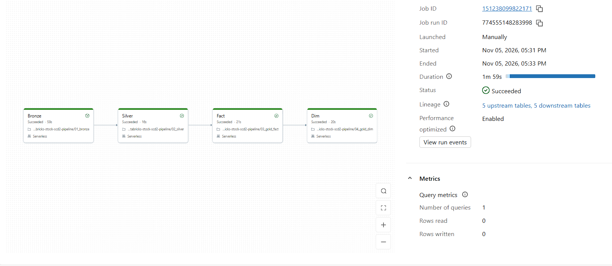

# Stock Market Data Pipeline on Databricks (Incremental Loads + SCD Type 2)

A daily pipeline that pulls stock prices from a public API, loads only the new trading days, and keeps a full history of how each company's attributes change over time.

**Status:** complete and tested (Nov 2026). Every number in this README comes from a real run.

## Why I built this

I'm a data engineer, and I'm interested in financial markets (I hold the NISM Series-8 Equity Derivatives certification). I wanted a project that works the way real data teams handle market data, not just a notebook that reads one CSV.

Two problems kept coming up when I read about financial reporting:

1. **Reloading everything every day is slow and risky.** If a job fails and someone re-runs it, prices can get counted twice.
2. **Overwriting loses history.** If a company's attributes change, a simple overwrite means an old report now shows today's values instead of the values that were true back then.

This project is my attempt to solve both of those properly.

## What the pipeline has to do

1. Load daily prices incrementally, so only new trading days get processed.
2. Be safe to re-run. Running it again should never create duplicates or change anything.
3. Keep the full history of company attributes using SCD Type 2.
4. Work within free-tier limits: the API allows 25 requests a day, and I'm using Databricks Free Edition.

## Results

| What I wanted to prove | What actually happened |
|---|---|
| Only new days get loaded | After 4 new trading days arrived (29 Oct, 30 Oct, 2 Nov, 3 Nov), the fact table inserted exactly 32 rows (4 days × 8 tickers) and updated 0 |
| Safe to re-run | I ran the full Job again with no new files. Bronze stayed at 3,201 rows, silver at 840, the fact MERGE changed 0 rows, and the dimension MERGE and INSERT changed 0 rows |
| Duplicates removed | 3,201 raw rows in bronze became 840 unique (ticker, trade_date) rows in silver, with 0 rejects |
| Real SCD Type 2 history | On 3 Nov, AAPL and MSFT closed below their 20-day moving average. The pipeline closed their old records (valid until 2 Nov) and opened new current ones from 3 Nov. The other 6 tickers kept a single record |
| History stays clean | 0 tickers with more than one current record, and 0 records that end before they start |
| Runs automatically in order | A Databricks Job with 4 tasks (bronze → silver → fact → dim) finished in 1 min 59 s on serverless compute |



## How it works

```
Alpha Vantage API (TIME_SERIES_DAILY)
      |  extract/extract.py (runs on my laptop)
      v
landing/prices_<TICKER>_<YYYY-MM-DD>.jsonl   +   reference/companies.csv
      |  uploaded to a Unity Catalog Volume
      v
Bronze   Auto Loader -> bronze_prices (+ load_ts, source_file), bronze_companies
      v
Silver   silver_prices: typed, deduplicated   |   silver_prices_rejects: values that failed to convert
      v
Gold     fact_daily_price  (watermark + MERGE)
         dim_company       (SCD Type 2 on name, sector, industry, trend_status)
```

| Step | What it does |
|---|---|
| Extract | Calls the API for 8 tickers. Retries network errors, catches API errors that come back inside a normal "200 OK" reply, waits between calls to stay under the rate limit, turns the date-keyed response into one row per day, and saves one JSON Lines file per ticker per day |
| Bronze | Auto Loader picks up only files it hasn't seen before (it keeps a checkpoint) and adds `load_ts` and `source_file` to every row. The notebook waits for the stream to finish so the next task never reads half-loaded data |
| Silver | Converts types with `try_cast` (dates, `DECIMAL(18,4)` prices, `BIGINT` volume). Any row where a value fails to convert goes to a rejects table instead of being silently dropped. Keeps the latest row per (ticker, trade_date) |
| Fact | Reads the last loaded date (the watermark), goes back 3 days to catch late corrections, and MERGEs on (ticker, trade_date). A row is only updated if a value actually changed |
| Dimension | Calculates `trend_status` (close vs 20-day moving average), joins it with the company reference file, and applies SCD Type 2 in two steps: a MERGE that closes changed records, then an INSERT (with a left anti join) that adds the new current records |
| Job | Runs the 4 notebooks in order. If one task fails, the later ones are skipped, and because every step is safe to re-run, I can just run the whole Job again |

### Decisions I made along the way

- **The company overview endpoint turned out to be premium.** I originally planned to get sector and industry from the API. Instead of dropping SCD Type 2, I changed the design: name, sector and industry come from a reference file I maintain (`companies.csv`), and I calculate an attribute that really changes with the market, `trend_status`.
- **Flatten in the extract, convert types in silver.** Bronze keeps the raw values, so if something goes wrong I can reprocess without calling the API again (which matters with only 25 calls a day).
- **I compare values with `<=>` (NULL-safe equals)** in both MERGEs, because a normal `<>` returns UNKNOWN when a value is NULL and would miss the change.
- **Same-day corrections update the record in place.** If an attribute changes on the same day a record started, I correct that record instead of closing it. Only a change on a later day closes the old record (valid until the day before) and opens a new one.
- **Current records use `9999-12-31` as `valid_to`**, so date-range filters work without special NULL handling.
- **`trend_status` rule:** close at or above the 20-day average is `above_avg`, below it is `below_avg`.
- **SCD Type 2 in two steps instead of one.** It's easier to read and debug. The downside is that if the job fails between the two steps, a company can be left without a current record until the next run, which fixes it.

## Problems I ran into and how I fixed them

1. **Schema drift.** My first batch of files had a column called `Trade_date` and the second batch had `trade_date`. Auto Loader didn't fail; it put 800 rows' values into `_rescued_data`. My rescued-row check caught it, I fixed the extract, and I reset bronze (table, checkpoint and schema location together) so everything loaded cleanly. Now the bronze notebook prints the rescued-row count on every run.
2. **A duplicate row inside a source file.** One AMZN file had 101 lines instead of 100 because the same day appeared twice. The silver dedupe (latest row per ticker and day) removed it, which is exactly why that step exists.
3. **SCD Type 2 records that ended before they started.** When an attribute changed on the same day a record began, my first version closed it with `valid_to` one day *before* its `valid_from`. The table had 10 records instead of 8. I added the same-day "update in place" rule, rebuilt the table, and added a permanent check that counts records ending before they start (it must be 0).

## Tests

| Test | What it proves | Result |
|---|---|---|
| Run the whole Job again with no new data | Nothing is duplicated or changed | Passed: every layer unchanged, both MERGEs changed 0 rows |
| Load day 1, then new days | Only new rows are processed | Passed: 32 rows inserted for 4 new trading days |
| Change NVDA's industry in `companies.csv` on the same day, then change it back | Same-day corrections update in place | Passed: still 8 records, `valid_from` unchanged |
| Real market change on a later day | Old record closed, new record current | Passed: AAPL and MSFT, closed on 2 Nov, new from 3 Nov |
| Row counts | Silver and the fact table match | Passed: 840 and 840 |
| Built-in checks on every run | No double current records, no impossible records, no rescued rows | All 0 |

## Data

| Source | What it gives | Notes |
|---|---|---|
| Alpha Vantage `TIME_SERIES_DAILY` | Daily open, high, low, close, volume | Free tier: 25 requests a day, 5 a minute. 8 tickers = 8 calls a day |
| `reference/companies.csv` | Name, sector, industry | I maintain this by hand |
| `trend_status` (calculated) | `above_avg` or `below_avg` vs the 20-day moving average | Changes with real prices, so the SCD2 history is real |

Tickers: AAPL, AMD, AMZN, GOOGL, IBM, MSFT, NVDA, TSLA

## How to run it

**Extract (on your computer)**

1. Create a `.env` file in the project folder with one line: `API_Key=your_key_here`. It's in `.gitignore`, so it never gets committed.
2. Install the packages: `pip install requests python-dotenv`
3. Run: `python extract/extract.py`
4. The files appear in `landing/` (also in `.gitignore`, because data files don't belong in the repo).

**Databricks**

1. Create the schema `workspace.stocks` and a Volume called `raw`.
2. Upload the landing files to `/Volumes/workspace/stocks/raw/prices/` and `companies.csv` to `/Volumes/workspace/stocks/raw/reference/`.
3. Import the 4 notebooks from `notebooks/` and create a Job with 4 notebook tasks in this order: `01_bronze` → `02_silver` → `03_gold_fact` → `04_gold_dim`.
4. Run the Job. Each notebook prints its own checks at the end.

## Limitations and next steps

- The extract runs on my laptop and I upload the files by hand. Next step: move the extract into Databricks with the API key stored as a secret, so the whole pipeline runs as one scheduled Job.
- The Job is triggered manually for now.
- The free API limits how many tickers I can track.
- Name, sector and industry are maintained by hand, not pulled live.
- Databricks Free Edition is serverless only and has fair-usage limits.

## Tech stack

Python (requests, python-dotenv), Databricks Free Edition, PySpark, Spark SQL, Delta Lake (MERGE, schema enforcement), Auto Loader, Unity Catalog Volumes, Databricks Jobs, Git/GitHub

## Repository layout

```
extract/      extract.py
reference/    companies.csv
notebooks/    01_bronze, 02_silver, 03_gold_fact, 04_gold_dim
docs/         job_run.png
README.md
```
