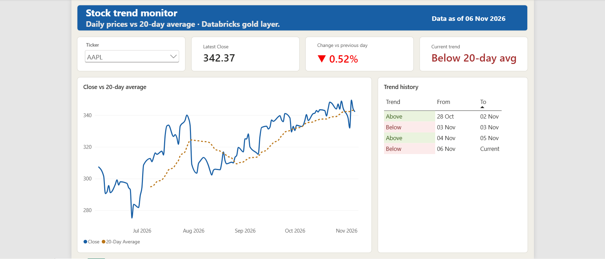

# Stock Market Data Pipeline on Databricks (Incremental Loads + SCD Type 2)

A daily pipeline that pulls stock prices from a public API, loads only the new trading days, and keeps a full history of how each company's attributes change over time. It runs on its own every morning and feeds a Power BI dashboard.

**Status:** complete, tested and scheduled (Nov 2026). Every number in this README comes from a real run.

## Why I built this

I'm a data engineer, and I'm interested in financial markets (I hold the NISM Series-8 Equity Derivatives certification). I wanted a project that works the way real data teams handle market data, not just a notebook that reads one CSV.

Two problems kept coming up when I read about financial reporting:

1. **Reloading everything every day is slow and risky.** If a job fails and someone re-runs it, prices can get counted twice.
2. **Overwriting loses history.** If a company's attributes change, a simple overwrite means an old report now shows today's values instead of the values that were true back then.

This project is my attempt to solve both of those properly.

## What the pipeline has to do

1. Run every trading day without anyone touching it.
2. Load prices incrementally, so only new trading days get processed.
3. Be safe to re-run. Running it again should never create duplicates or change anything.
4. Keep the full history of company attributes using SCD Type 2.
5. Work within free-tier limits: the API allows 25 requests a day, and I'm using Databricks Free Edition.

## Results

| What I wanted to prove | What actually happened |
|---|---|
| Runs on its own | The Job runs Tuesday to Saturday at 7:00 AM IST (the morning after each US trading day). The first two scheduled runs, on 6 and 7 Nov, both succeeded with no manual steps |
| Only new days get loaded | In the 6 Nov scheduled run, one new trading day arrived. The fact table re-checked 32 recent rows and inserted exactly 8 (1 day × 8 tickers), updating 0 |
| Safe to re-run | I ran the full Job again with no new files. Every layer stayed the same, and both MERGEs changed 0 rows |
| Duplicates removed | Bronze keeps every raw row (4,801 after the 6 Nov run); silver keeps one row per ticker and day (856), with 0 rejects |
| Real SCD Type 2 history | Records close and open as the market moves. For example, AAPL and MSFT dropped below their 20-day average on 3 Nov and moved back above it on 4 Nov, and AMZN moved above it on 4 Nov. After the 6 Nov run the table held 14 records for 8 tickers |
| History stays clean | Every run checks for tickers with more than one current record and for records that end before they start. Both are 0 |
| Bad input is blocked | Tickers that aren't in my company list go to a rejects table instead of the clean data (tested with a fake ticker) |


## Dashboard

A one-page Power BI report built on the gold layer. Pick a ticker and it shows the latest close, the change from the previous trading day, the current trend, the price against its 20-day average, and the full SCD Type 2 history of the trend.



In the screenshot, AAPL's trend history shows four records that follow each other with no gaps or overlaps: above its average from 28 Oct, below on 3 Nov, above again on 4–5 Nov, and below from 6 Nov.

How I built it:

- **Import mode, not DirectQuery.** The data is small, so Power BI keeps its own copy and the report works even while the Databricks SQL warehouse is switched off. The trade-off is that it's a snapshot: it only shows new days after a refresh.
- **A current-company table to avoid double counting.** `dim_company` has several records per ticker, so relating it directly to the prices would be a many-to-many relationship. I filtered it to `is_current = true` in Power Query (one row per ticker) and used that for a clean one-to-many relationship. The full history table is only used for the history visual.
- **Prices are never summed.** I turned off default summing on price columns, because adding up a stock's close prices over 100 days gives a meaningless number.
- **"Previous day" means the previous trading day.** The change measure in DAX looks for the latest date before the last one, instead of subtracting one calendar day, so it still works after weekends and holidays.
- **The 20-day average comes from the data layer** (the `v_price_trend` view), not from DAX, so the dashboard and any other tool show the same number.

## How it works

```
Daily schedule (Tue–Sat, 7:00 AM IST)
      v
00 Extract   Alpha Vantage API -> JSON Lines files in a Unity Catalog Volume
             (API key read from a Databricks secret)
      v
01 Bronze    Auto Loader -> bronze_prices (+ load_ts, source_file), bronze_companies
      v
02 Silver    silver_prices: approved tickers, typed, deduplicated
             silver_prices_rejects: unknown tickers + values that failed to convert
      v
03 Fact      fact_daily_price (watermark + MERGE)
      v
04 Dim       dim_company (SCD Type 2 on name, sector, industry, trend_status)

Gold view    v_price_trend: close + 20-day moving average, for reporting
```

| Step | What it does |
|---|---|
| Extract | Runs inside Databricks. Reads the API key from a secret (it never appears in code), calls the API for 8 tickers, retries network errors, catches API errors that come back inside a normal "200 OK" reply, waits between calls to stay under the rate limit, and writes one JSON Lines file per ticker per day straight into the Volume |
| Bronze | Auto Loader picks up only files it hasn't seen before (it keeps a checkpoint) and adds `load_ts` and `source_file` to every row. The notebook waits for the stream to finish, so the next task never reads half-loaded data |
| Silver | Keeps only tickers listed in `companies.csv` (a `left_semi` join); anything else goes to the rejects table (`left_anti`). Converts types with `try_cast` and sends rows that fail to convert to rejects as well. Keeps the latest row per (ticker, trade_date) |
| Fact | Reads the last loaded trade date (the watermark), goes back 3 days to catch corrections the API makes to recent days, and MERGEs on (ticker, trade_date). A row is only updated if a value actually changed |
| Dimension | Calculates `trend_status` (close vs 20-day moving average), joins it with the company list, and applies SCD Type 2 in two steps: a MERGE that closes changed records, then an INSERT (with a left anti join) that adds the new current records |
| Job | Runs the 5 notebooks in order on serverless compute. If a task fails, the later ones are skipped. Because every step is safe to re-run, a repair run re-runs only the failed task and the ones after it, so the API isn't called again |
| Reporting view | `v_price_trend` adds a 20-day moving average to every price. It returns NULL until a stock has 20 days of history, so it never shows a "20-day" average built from fewer days |

### Decisions I made along the way

- **The company overview endpoint turned out to be premium.** I originally planned to get sector and industry from the API. Instead of dropping SCD Type 2, I changed the design: name, sector and industry come from a reference file I maintain (`companies.csv`), and I calculate an attribute that really changes with the market, `trend_status`.
- **The extract runs inside Databricks.** I first ran it on my laptop and uploaded the files by hand. Moving it into the Job removed the manual step, and storing the key as a Databricks secret means it never sits in a file or a notebook.
- **Flatten in the extract, convert types in silver.** Bronze keeps the raw values, so if something goes wrong I can reprocess without calling the API again (which matters with only 25 calls a day).
- **I compare values with `<=>` (NULL-safe equals)** in both MERGEs, because a normal `<>` returns UNKNOWN when a value is NULL and would miss the change.
- **Same-day corrections update the record in place.** If an attribute changes on the same day a record started, I correct that record instead of closing it. Only a change on a later day closes the old record (valid until the day before) and opens a new one.
- **Current records use `9999-12-31` as `valid_to`**, so a single `BETWEEN valid_from AND valid_to` filter works for every record without special NULL handling.
- **`trend_status` rule:** close at or above the 20-day average is `above_avg`, below it is `below_avg`.
- **Business logic lives in the data layer.** The moving average is calculated in a Databricks view, not in the dashboard, so every tool that reads gold gets the same number.
- **SCD Type 2 in two steps instead of one.** It's easier to read and debug. The downside is that if the job fails between the two steps, a company can be left without a current record until the next run, which fixes it.

### A trade-off I'd change in production

`trend_status` changes much faster than a typical SCD Type 2 attribute: AAPL went above, below and above its average again within three days. SCD Type 2 is designed for slowly changing attributes like sector or industry. I kept it here because it gives the history logic real changes to handle, but in production I would either store `trend_status` per day in the fact table, or smooth it (for example, only count a change if it holds for three days in a row).

## Problems I ran into and how I fixed them

1. **Schema drift.** My first batch of files had a column called `Trade_date` and the second batch had `trade_date`. Auto Loader didn't fail; it put 800 rows' values into `_rescued_data`. My rescued-row check caught it, I fixed the extract, and I reset bronze (table, checkpoint and schema location together). The bronze notebook now prints the rescued-row count on every run.
2. **A duplicate row inside a source file.** One AMZN file had 101 lines instead of 100 because the same day appeared twice. The silver dedupe (latest row per ticker and day) removed it, which is exactly why that step exists.
3. **SCD Type 2 records that ended before they started.** When an attribute changed on the same day a record began, my first version closed it with `valid_to` one day *before* its `valid_from`. The table had 10 records instead of 8. I added the same-day "update in place" rule, rebuilt the table, and added a permanent check that counts records ending before they start (it must be 0).
4. **The API returned the wrong companies without any error.** After a one-ticker test, I left two stray symbols (`I` and `M`) in the ticker list. The API answered with 200 OK and real data for two other securities, and nothing failed. My bronze checks showed 10 tickers instead of 8 and 206 dates instead of 106. I deleted the two files and their rows, corrected the list, and added the approved-ticker filter in silver, so an unknown ticker now goes to rejects instead of the clean data.

## Tests

| Test | What it proves | Result |
|---|---|---|
| Run the whole Job again with no new data | Nothing is duplicated or changed | Passed: every layer unchanged, both MERGEs changed 0 rows |
| New trading days arrive | Only new rows are processed | Passed: 32 rows inserted for 4 new days, then 8 rows for 1 new day |
| Change NVDA's industry in `companies.csv` on the same day, then change it back | Same-day corrections update in place | Passed: still 8 records, `valid_from` unchanged |
| Real market change on a later day | Old record closed, new record current | Passed: AAPL and MSFT on 3 Nov, AMZN on 4 Nov |
| Unknown ticker | Goes to rejects, not to the clean data | Passed: a fake ticker was caught by the filter |
| Scheduled runs | The Job runs without anyone starting it | Passed: 6 and 7 Nov |
| Built-in checks on every run | No double current records, no impossible records, no rescued rows | All 0 |

## Data

| Source | What it gives | Notes |
|---|---|---|
| Alpha Vantage `TIME_SERIES_DAILY` | Daily open, high, low, close, volume | Free tier: 25 requests a day, 5 a minute. 8 tickers = 8 calls a day |
| `reference/companies.csv` | Name, sector, industry, and the list of approved tickers | I maintain this by hand |
| `trend_status` (calculated) | `above_avg` or `below_avg` vs the 20-day moving average | Changes with real prices, so the SCD2 history is real |

Tickers: AAPL, AMD, AMZN, GOOGL, IBM, MSFT, NVDA, TSLA

## How to run it

1. In Databricks, create the schema `workspace.stocks` and a Volume called `raw`. Upload `companies.csv` to `/Volumes/workspace/stocks/raw/reference/`.
2. Store the Alpha Vantage key as a secret with the Databricks CLI:
   ```
   databricks secrets create-scope stocks
   databricks secrets put-secret stocks alpha_vantage_key
   ```
3. Import the notebooks from `notebooks/` and create a Job with 5 notebook tasks in this order: `00_extract` → `01_bronze` → `02_silver` → `03_gold_fact` → `04_gold_dim`.
4. Add a schedule trigger (I use `0 0 7 ? * TUE-SAT`, time zone Asia/Kolkata).
5. Create the reporting view with `sql/v_price_trend.sql`.
6. Open `dashboard/stock_dashboard.pbix` in Power BI Desktop and point the Databricks connection at your own SQL warehouse (server hostname and HTTP path from the warehouse's Connection details tab).

Each notebook prints its own checks at the end. `extract/extract.py` is the original laptop version of the extract (it reads the key from a local `.env` file, which is in `.gitignore`).

## Limitations

- The free API limits how many tickers I can track.
- Name, sector and industry are maintained by hand, not pulled live.
- Databricks Free Edition is serverless only and has fair-usage limits.
- The 20-day moving average is NULL for each stock's first 19 days of data.
- The dashboard is refreshed by hand in Power BI Desktop (scheduled refresh needs the Power BI service).

## Tech stack

Python (requests), Databricks Free Edition, PySpark, Spark SQL, Delta Lake (MERGE, schema enforcement), Auto Loader, Unity Catalog (Volumes, views), Databricks Jobs (scheduling, repair runs), Databricks secrets and CLI, Databricks SQL warehouse, Power BI (Power Query, DAX), Git/GitHub

## Repository layout

```
extract/      extract.py (laptop version)
reference/    companies.csv
notebooks/    00_extract, 01_bronze, 02_silver, 03_gold_fact, 04_gold_dim
sql/          v_price_trend.sql
dashboard/    stock_dashboard.pbix
docs/         job_run.png, dashboard.png
README.md
```
